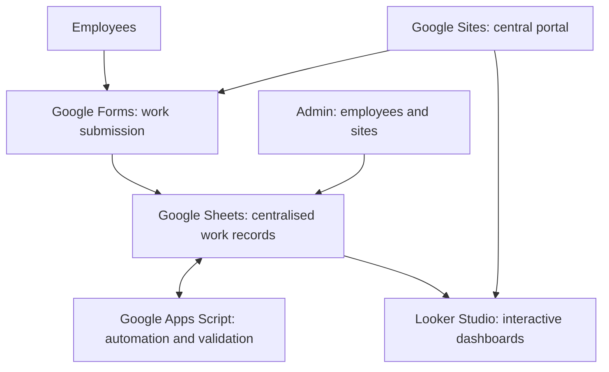

# Workforce Reporting & Analytics System

A Google Workspace-based workforce reporting solution developed for a real client to replace manual, message-based work reporting with structured digital submissions, centralised records, automated administration, and interactive dashboards.

> **Portfolio edition:** This repository is intended for a privacy-safe technical showcase. It excludes live client records, private links, credentials, and identifying information. Two sanitised Apps Script source files are included. Publication still requires confirmation of client permission.

## Project overview

The client previously relied on WhatsApp messages to communicate work completed. This made it difficult to organise records and produce consistent site, employee, and monthly reports. The solution uses Google Forms for data capture, Google Sheets for structured storage, Google Apps Script for automation, Looker Studio for reporting, and Google Sites as a central access point.

## Solution architecture



## Key capabilities

- Structured daily work submissions through Google Forms.
- Centralised work records in Google Sheets.
- Administration of employee and site reference lists, including active/inactive status.
- Apps Script-driven updates to form choices and supporting workflow automation.
- Interactive Looker Studio reports with employee, site, and date filtering.
- Reporting by site and employee, with summary measures for work activity.
- A Google Sites hub connecting data entry and reporting workflows.

**Implementation note:** Some updates depend on Apps Script trigger intervals and Looker Studio refresh behaviour. Do not describe the system as providing guaranteed instant synchronization.

## Project scale

At the last recorded snapshot, the system covered **13 employees**, **6 sites**, and **101 work records**. These figures document the project at that point in time and are not live statistics.

## My role

I designed and implemented the workflow and reporting prototype, including the Google Forms-to-Sheets data capture process, Apps Script administration and automation, and Looker Studio reporting.

## Repository contents

```text
workforce-reporting-analytics-system/
├── README.md
├── .gitignore
├── src/                  # ReportingSync.gs and DirectoryManagement.gs
├── docs/
│   ├── architecture.md
│   ├── setup.md
│   ├── code-guide.md
│   └── data-dictionary.md
├── screenshots/          # Anonymised interface and dashboard images
└── data/                 # Synthetic examples only
```

## Apps Script implementation

The repository includes two production-derived modules, with the live Google Form ID removed:

- [`ReportingSync.gs`](src/ReportingSync.gs): Maintains persistent job IDs, expands checkbox selections into individual employee rows, and rebuilds the `Reporting Data` sheet used by dashboards.
- [`DirectoryManagement.gs`](src/DirectoryManagement.gs): Automatically assigns employee/site IDs, enforces Active/Inactive status, synchronises Google Form choices, and handles registration requests.

The form ID is supplied through the private `WORKFORCE_FORM_ID` Apps Script property in a demo installation. See the [source code guide](docs/code-guide.md) and [setup steps](docs/setup.md).

## Screenshots

Add anonymised screenshots to `screenshots/` and reference them here once approved for sharing:

- Employee work submission form
- Data management spreadsheet (sample or masked records only)
- Reporting dashboard overview
- Site or employee filtered dashboard
- Google Sites portal (without private URLs)

## Implementation and reproducibility

This is a Google Workspace solution, not a standalone application. Reusing it requires a new Google Form, Sheet, Apps Script project, and Looker Studio report. See [setup notes](docs/setup.md) for an overview. Do not copy a production spreadsheet or its live dataset into a public repository.

## Privacy and ownership

This repository intentionally does not contain client-owned data or private account settings. Any shared source code, design assets, screenshots, or implementation details should be cleared for publication by the client or other applicable rights holder.

## Roadmap / ideas

- Test the included sanitised Apps Script source in a separate demo environment.
- Verify the documented trigger configuration against a demo form and sheet.
- Include anonymised dashboard screenshots and example reports.
- Add a fully synthetic sample dataset and reproducible setup instructions.

---

*Portfolio case study. Live system access is not provided.*
