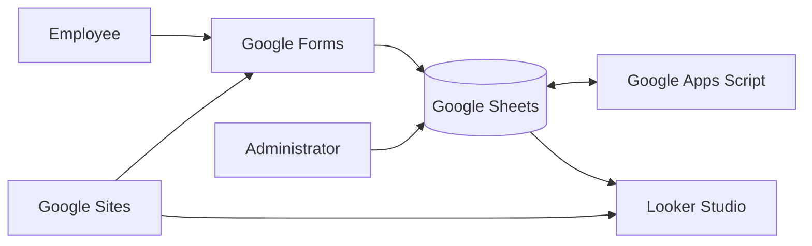

# System architecture

## Data flow

1. Employees submit a work record using a Google Form.
2. Submissions are stored in a Google Sheets-based workbook.
3. Administrators maintain employee and site reference lists.
4. Google Apps Script supports administration, form choice updates, and synchronisation of the reporting workflow.
5. Looker Studio reads prepared sheet data for reports by date, site, and employee.
6. Google Sites provides a central entry point for staff and administrators.

## Design considerations

- **Low-cost operations:** Uses familiar Google Workspace services instead of a custom database server.
- **Data consistency:** Employee and site lists are centrally managed.
- **Automation:** Scripts reduce repetitive manual maintenance but can have scheduled execution and refresh delays.
- **Reporting:** Looker Studio offers filterable summaries; report freshness depends on connector and caching behaviour.
- **Access control:** Google account permissions must be configured separately for forms, spreadsheets, reports, and portals.
- **Privacy:** Production identifiers and employee records are deliberately excluded from the public repository.

## Current limitations

This portfolio repository does not contain a runnable copy of the client environment. Integration details must be recreated in a separate demonstration workspace.
